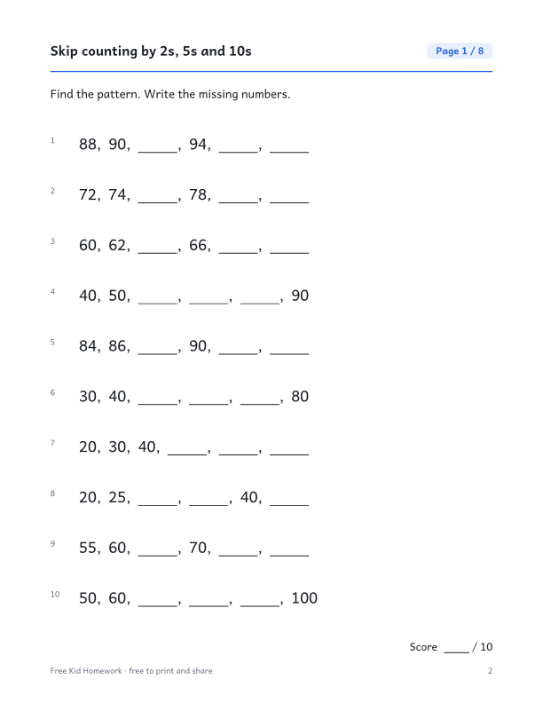

::: {.wb}
::: {.wb-preview}

:::
::: {.wb-info}
[Download the PDF (10 pages)](grade-1-skip-counting-by-2s-5s-and-10s.pdf){.btn .btn-primary .btn-lg .wb-download}

Number patterns counting forward by 2, 5 and 10 up to 100, which prepares children for multiplication. This free printable workbook has 8 practice pages with 80 problems in total (10 per page) and a full answer key on the last page. No sign-up and no email needed: download the PDF and print it.

### What's inside

- 10 pages: cover, 8 practice pages and an answer key
- 10 problems per page, with room to write the answers
- Every workbook contains different problems from page to page
- US Letter size, prints cleanly in black and white

[Aussi disponible en français](/fr/annee-1/compter-par-bonds-de-2-5-et-10.qmd){hreflang=fr} · [More Grade 1 workbooks](/index.qmd#category=Grade%201)
:::
:::
