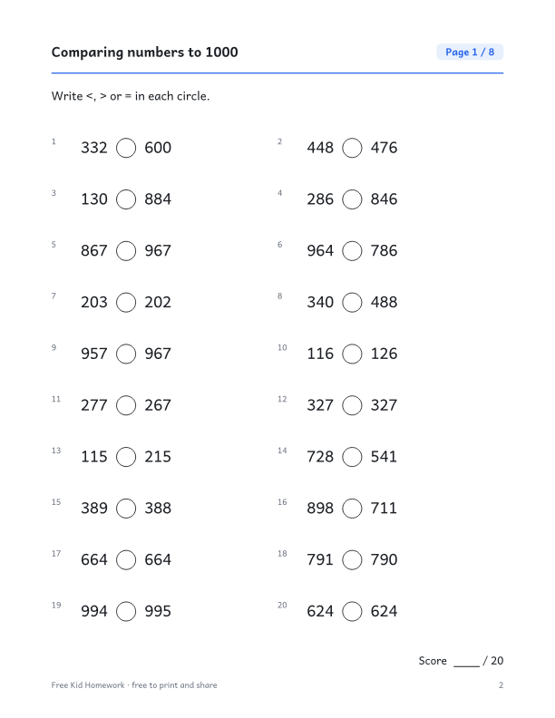

::: {.wb}
::: {.wb-preview}

:::
::: {.wb-info}
[Download the PDF (10 pages)](grade-2-comparing-numbers-to-1000.pdf){.btn .btn-primary .btn-lg .wb-download}

Compare 3-digit numbers using <, > and =, with many close pairs that differ by a single digit. This free printable workbook has 8 practice pages with 160 problems in total (20 per page) and a full answer key on the last page. No sign-up and no email needed: download the PDF and print it.

### What's inside

- 10 pages: cover, 8 practice pages and an answer key
- 20 problems per page, with room to write the answers
- Every workbook contains different problems from page to page
- US Letter size, prints cleanly in black and white

[Aussi disponible en français](/fr/annee-2/comparer-les-nombres-jusqu-a-1000.qmd){hreflang=fr} · [More Grade 2 workbooks](/index.qmd#category=Grade%202)
:::
:::
