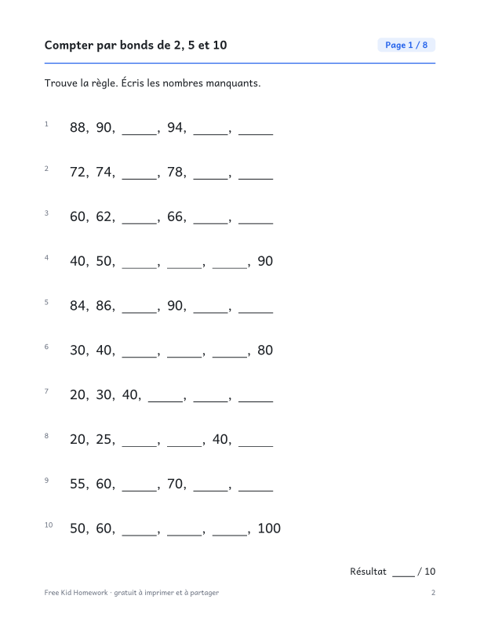

::: {.wb}
::: {.wb-preview}

:::
::: {.wb-info}
[Télécharger le PDF (10 pages)](1re-annee-compter-par-bonds-de-2-5-et-10.pdf){.btn .btn-primary .btn-lg .wb-download}

Des suites de nombres par bonds de 2, 5 et 10 jusqu'à 100, pour préparer la multiplication. Ce cahier gratuit à imprimer contient 8 pages d'exercices, soit 80 exercices au total (10 par page), et un corrigé complet à la dernière page. Aucune inscription ni adresse courriel : téléchargez le PDF et imprimez-le.

### Contenu du cahier

- 10 pages : couverture, 8 pages d'exercices et un corrigé
- 10 exercices par page, avec de la place pour écrire les réponses
- Les exercices changent d'une page à l'autre
- Format Lettre, s'imprime bien en noir et blanc

[Also available in English](/en/grade-1/skip-counting-by-2s-5s-and-10s.qmd){hreflang=en} · [Autres cahiers de 1re année](/fr/index.qmd#category=1re%20ann%C3%A9e)
:::
:::
