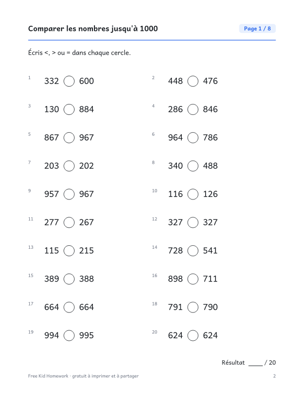

::: {.wb}
::: {.wb-preview}

:::
::: {.wb-info}
[Télécharger le PDF (10 pages)](2e-annee-comparer-les-nombres-jusqu-a-1000.pdf){.btn .btn-primary .btn-lg .wb-download}

Comparer des nombres à 3 chiffres avec <, > et =, avec des nombres proches qui ne diffèrent que d'un chiffre. Ce cahier gratuit à imprimer contient 8 pages d'exercices, soit 160 exercices au total (20 par page), et un corrigé complet à la dernière page. Aucune inscription ni adresse courriel : téléchargez le PDF et imprimez-le.

### Contenu du cahier

- 10 pages : couverture, 8 pages d'exercices et un corrigé
- 20 exercices par page, avec de la place pour écrire les réponses
- Les exercices changent d'une page à l'autre
- Format Lettre, s'imprime bien en noir et blanc

[Also available in English](/en/grade-2/comparing-numbers-to-1000.qmd){hreflang=en} · [Autres cahiers de 2e année](/fr/index.qmd#category=2e%20ann%C3%A9e)
:::
:::
