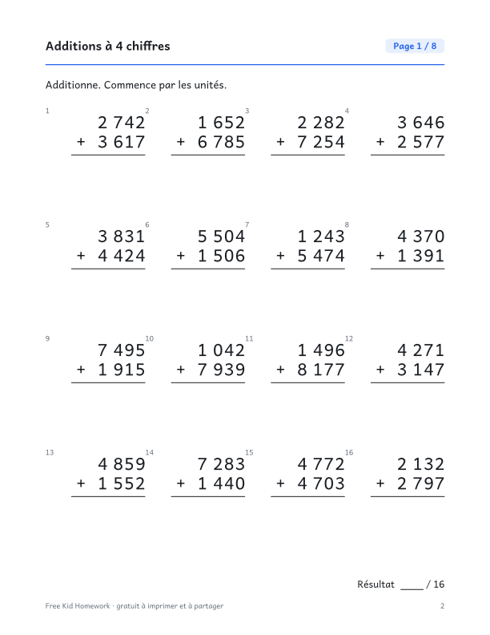

::: {.wb}
::: {.wb-preview}

:::
::: {.wb-info}
[Télécharger le PDF (10 pages)](4e-annee-additions-a-4-chiffres.pdf){.btn .btn-primary .btn-lg .wb-download}

Des additions posées de nombres à 4 chiffres avec retenues, jusqu'à 9 999. Ce cahier gratuit à imprimer contient 8 pages d'exercices, soit 128 exercices au total (16 par page), et un corrigé complet à la dernière page. Aucune inscription ni adresse courriel : téléchargez le PDF et imprimez-le.

### Contenu du cahier

- 10 pages : couverture, 8 pages d'exercices et un corrigé
- 16 exercices par page, avec de la place pour écrire les réponses
- Les exercices changent d'une page à l'autre
- Format Lettre, s'imprime bien en noir et blanc

[Also available in English](/en/grade-4/4-digit-addition.qmd){hreflang=en} · [Autres cahiers de 4e année](/fr/index.qmd#category=4e%20ann%C3%A9e)
:::
:::
