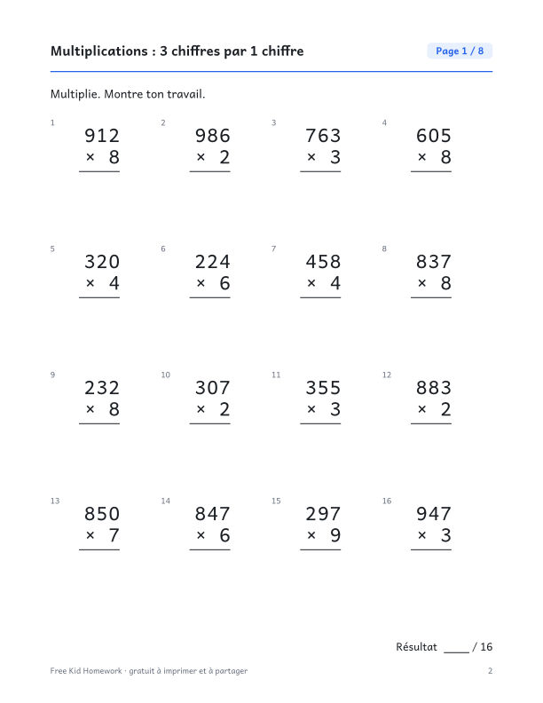

::: {.wb}
::: {.wb-preview}

:::
::: {.wb-info}
[Télécharger le PDF (10 pages)](4e-annee-multiplications-3-chiffres-par-1-chiffre.pdf){.btn .btn-primary .btn-lg .wb-download}

Des multiplications posées d'un nombre à 3 chiffres par un nombre à 1 chiffre. Ce cahier gratuit à imprimer contient 8 pages d'exercices, soit 128 exercices au total (16 par page), et un corrigé complet à la dernière page. Aucune inscription ni adresse courriel : téléchargez le PDF et imprimez-le.

### Contenu du cahier

- 10 pages : couverture, 8 pages d'exercices et un corrigé
- 16 exercices par page, avec de la place pour écrire les réponses
- Les exercices changent d'une page à l'autre
- Format Lettre, s'imprime bien en noir et blanc

[Also available in English](/en/grade-4/multiplying-3-digit-by-1-digit-numbers.qmd){hreflang=en} · [Autres cahiers de 4e année](/fr/index.qmd#category=4e%20ann%C3%A9e)
:::
:::
